# ProjectPlug: coding & engineering projects, built for students

**ProjectPlug** ("ur project plug 🔌") is a website and installable phone app where students anywhere in the world get working projects: CS students, coding bootcamp batches, self-taught devs and engineering students. There are 68 ready projects across web, mobile, AI, data, cybersecurity, web3, games, cloud, core CS and hardware, or students can pitch their own idea and get an instant estimate. Prices start at ₹12,000 and **every price is negotiable**: students make an offer, and you settle it in a chat on their order page. They pay by UPI, PayPal or card (teams can **split the price**, each paying from their own link), track progress and download the files. Projects show **demo videos** and **verified reviews**, and every order comes with a **friend code** that brings in new students. You run everything from an owner panel.

**Live:** https://projectplug.vercel.app (owner panel at `/admin`).

The name is only a default: change it, the tagline and everything else in **Admin → Settings**.

| Home | Catalogue |
|---|---|
| 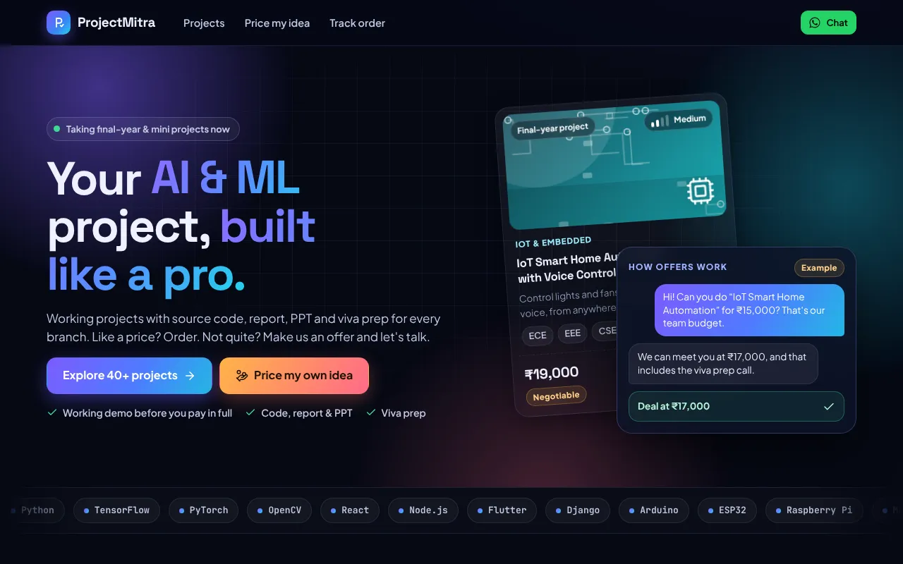 | 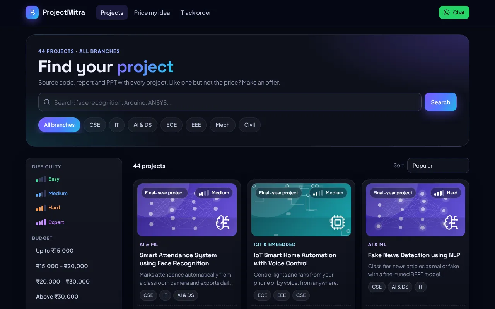 |

| Project page | Make an offer | Your counter-offer | Pay by UPI | Paying from abroad |
|---|---|---|---|---|
| 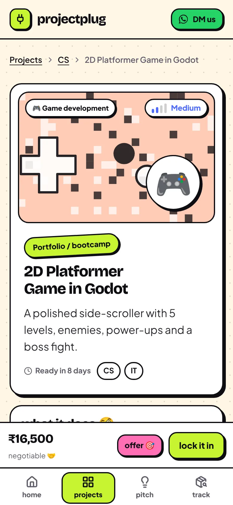 | 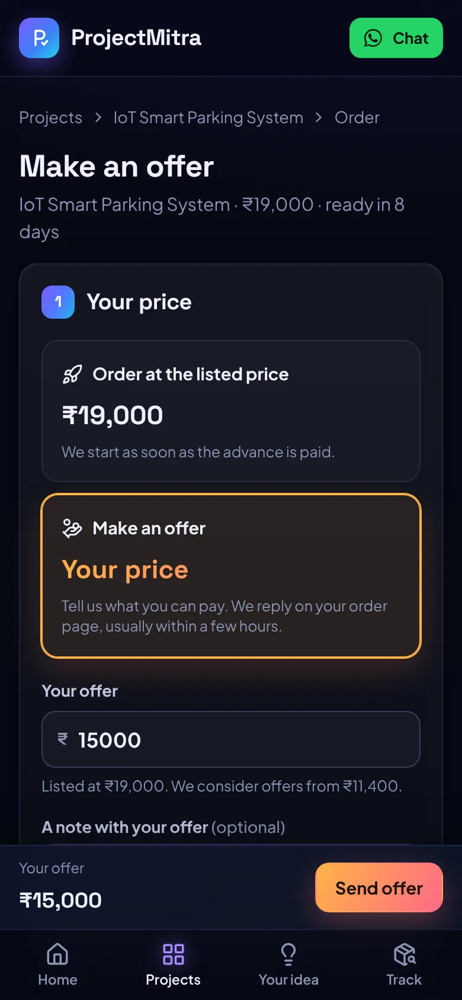 | 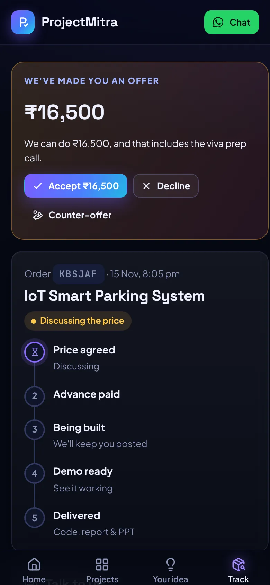 | 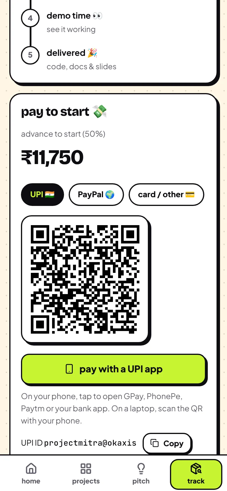 | 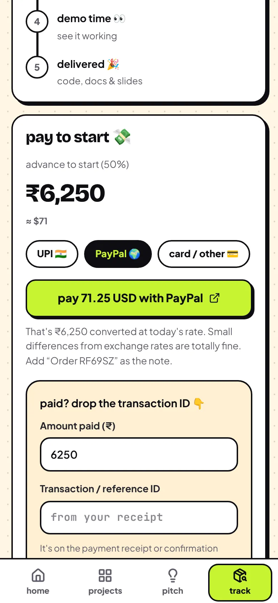 |

| Owner: the conversation on an order | Owner dashboard |
|---|---|
| 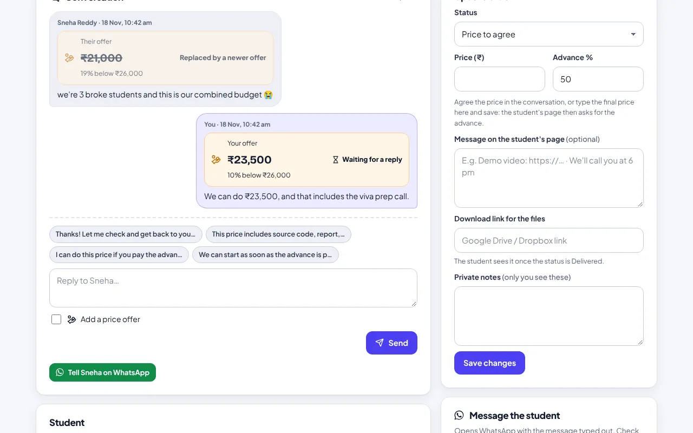 | 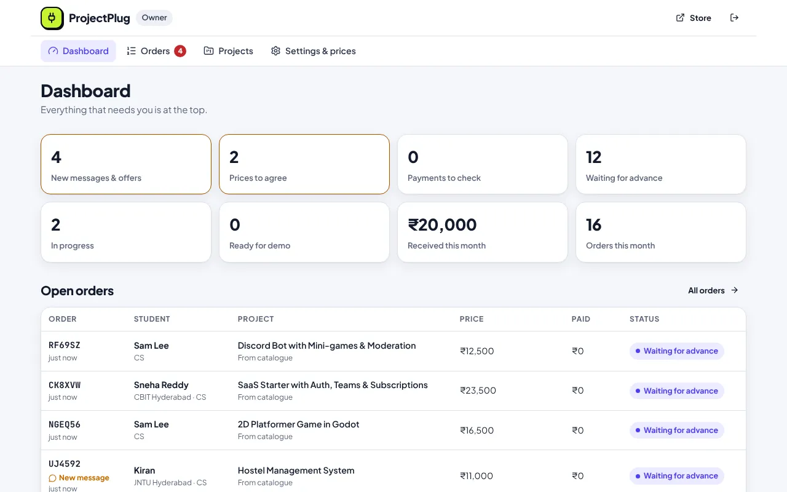 |

| Split with your squad | A teammate's own pay link | Friend code |
|---|---|---|
| 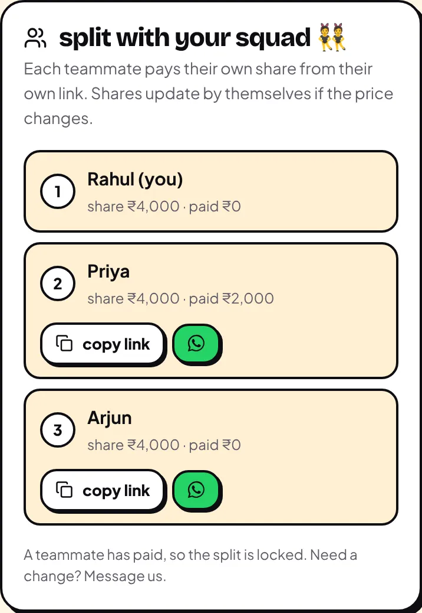 | 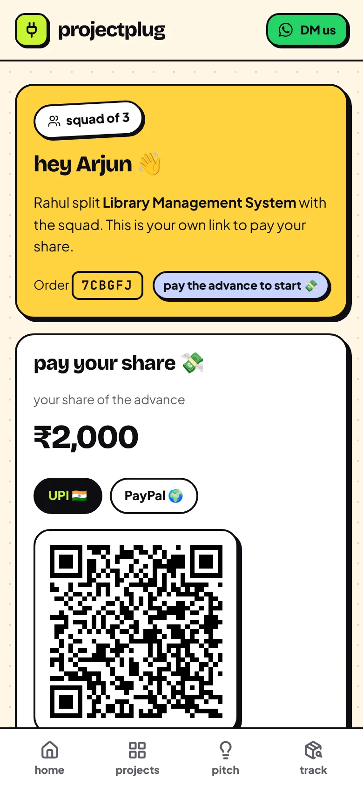 | 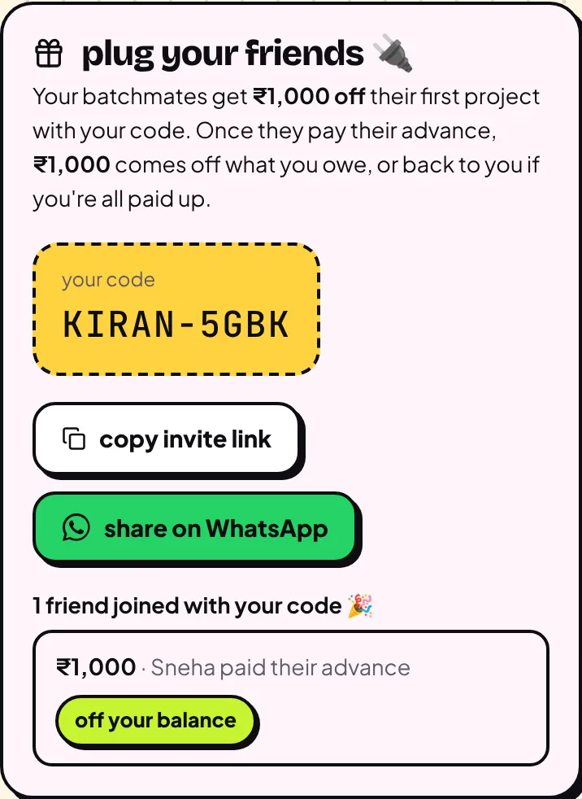 |

**Verified reviews** on the home page, the project pages and `/reviews`:

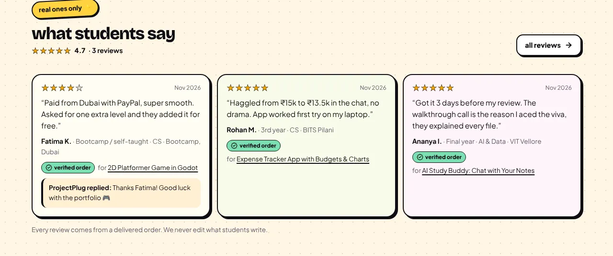

**Look:** Gen Z all the way for students: cream paper, thick black outlines, chunky "press-down" buttons, loud lime / pink / yellow, sticker badges, emoji, lowercase headlines, a scrolling ticker, and casual copy ("shoot your shot 🎯", "lock it in 🔒", "we're cooking 🧑‍🍳"). Motion switches off for people who ask for reduced motion. The owner panel stays clean and plain.

**Stack:** Next.js 15 (App Router, TypeScript) · Postgres (free Supabase database in production, a built-in one for development) · deploys to Vercel. No paid services needed.

## What students can do

- **Browse 68 sample projects** (₹12,000 – ₹38,000) in 15 tracks: 🌐 web apps & bots, 📱 mobile, 🤖 AI/ML, 📊 data, 🔐 cyber, ⛓️ web3, 🎮 games, ☁️ cloud & DevOps, 🧠 core CS (compilers, distributed systems, DSA), plus 🔌 IoT, ⚡ power & EV, 💾 VLSI, 📐 CAD, 🛠️ mechanical builds and 🧪 research. Filter by track, difficulty (Easy, Medium, Hard, Expert), budget, what it's for (mini project, final-year/capstone, portfolio/bootcamp) and field of study. Every project has its own artwork drawn from its track.
- **See exactly what they get:** source code, docs/report, slides, demo video, viva or interview Q&A, a README and deployment help for portfolio projects, and the hardware kit or working model for hardware projects.
- **Watch it working:** a project can have a demo video (YouTube, Shorts, Vimeo, Loom, Google Drive, Instagram or an .mp4) that plays right on its page, and a "try the live demo" link. YouTube loads only when they tap play. Projects with a demo get a "▶ demo" badge in the catalogue.
- **Read real reviews:** star ratings and reviews from delivered orders only, with a "verified order" badge, your public replies, the average on project cards, and a page of all reviews (`/reviews`). Search engines see the rating too.
- **Order** at the listed price with optional extras (viva-prep call, code walkthrough video, IEEE paper write-up, priority delivery) and a deadline.
- **Make an offer instead:** "Make an offer" on any project lets them name their price with a note ("we're a team of 3, this is our budget"). Nothing to pay until you agree.
- **Bargain in a chat:** their order page has a conversation with you. They see your counter-offer with **Accept** / **Decline** buttons, can send their own counter-offer, or just ask questions. The page refreshes by itself, so replies appear without reloading.
- **Price their own idea:** they pick the domain, difficulty and deadline, see the estimate change as they go, and add what they can pay. Their budget arrives as an offer you can accept in one tap.
- **Pay from anywhere:** in India, a UPI QR code and "pay with a UPI app" button for the exact amount. Abroad, a PayPal button with the amount already converted to their currency, or your card payment link. Then they type the transaction ID so you can check it.
- **Split it with the squad:** on their order page, a team of 2–6 splits the price. Every teammate gets their own link (share by WhatsApp) showing their share, a UPI QR / PayPal / card for just that amount, and who in the squad has paid. Teammate pages show nothing private: no chat, no phone numbers. Shares follow the price if it changes, and the split locks once a teammate has paid. When everyone's part of the advance is in, work starts by itself.
- **Bring friends, save money:** every order has a friend code (like `RAHUL-K7QM`) and an invite link (`/r/RAHUL-K7QM`). A friend who opens the link sees "Rahul's friend code is on: ₹1,000 off", and the code is already filled in on the order form. Once the friend pays their advance, the student who shared gets ₹1,000 off what they still owe, or it's listed as money you owe them. Codes work on a student's first order only, and nobody can use their own.
- **Leave a review** once the project is delivered: stars, a few words, the name to show, and whether to show their college.
- **See prices in their own currency:** a student in the US sees "≈ $190" next to "₹16,500", one in Europe "≈ €160". Picked automatically from their country, or chosen in the footer. (Rates update twice a day; built-in rates are used if the rate service can't be reached.)
- **Track the order** (price agreed 🤝 → advance paid 💸 → cooking 🧑‍🍳 → demo time 👀 → delivered 🎉) and download the files when it's done. Their orders are remembered on their phone, or they can find one with the order code and phone number.
- **WhatsApp everywhere:** every page can open a chat with you, with the project or order already typed in. Phone numbers from any country work (with their country code).
- **Install it as an app:** on Android, "Install the app" adds it to the home screen with a bottom tab bar; on iPhone, Share → Add to Home Screen.
- **Share links that look good:** a shared project shows a preview card with its title, price and difficulty in WhatsApp and Instagram.

## What you (the owner) can do — `/admin`

- **Dashboard:** new messages and offers, prices still to agree, payments to check, orders by stage, money received this month.
- **Answer offers:** each order has the whole conversation. Tap **Accept** on a student's offer, **Decline** it, or send your own price ("We can do ₹16,500 including the viva prep call"). Quick replies fill in common answers. When a price is accepted by either side, the order moves to *Waiting for advance* and the student sees the UPI QR code.
- **Bargaining rules** (Settings): the lowest offer you'll look at (default 60% of the price; lower offers are refused politely), and an optional auto-accept level (e.g. 90%: any offer that high is a deal at once). You can also turn offers off.
- **Or just set the price:** type the final price on the order and save; the student's page then asks for the advance. One tap opens WhatsApp with the price and payment link ready to send.
- **Check payments:** search the UTR in your bank or UPI app, then tap **Received** or **Not received**. When the advance is in, the order moves to *In progress* by itself. You can also record cash or bank payments.
- **Deliver:** upload the files to Google Drive (share with "anyone with the link"), paste the link, set the status to *Delivered*. The student gets a download button.
- **Ready-made WhatsApp messages** for each stage: price and payment link, payment received, demo ready, files delivered, **ask for a review**, and **share your friend code**.
- **Catalogue:** add, edit, hide or feature projects, with a demo video link and a live demo link. The form suggests a price from your pricing rules.
- **Reviews** (`/admin/reviews`): nothing shows until you **Publish** it. Hide or delete reviews, and reply publicly.
- **Squads:** an order's page shows each teammate's share and what they've paid, payments are labelled "from Priya", and you can record a cash payment against a teammate.
- **Referrals** (`/admin/referrals`): rewards taken off students' balances, and the ones you owe (students who had nothing left to pay): send the money, then **Mark paid**. Change the friend discount and reward, or turn codes off, in Settings.
- **Discounts:** each order has a discount field (friend codes and rewards fill it in; you can add your own). The student pays the price minus the discount, and the advance is worked out on that.
- **Settings & prices:** business name, WhatsApp number, UPI ID, advance %, base price per difficulty, multiplier per domain, rush charges, extras, friend codes, and the payment/refund policy text.

## How prices work

**Ready-made projects** have the price you set on each one.

**Students' own ideas** get an estimate:

```
base price for the difficulty × domain multiplier  +  rush charge  +  extras
```

| Difficulty | Base (default) | | Domain | Multiplier (default) |
|---|---|---|---|---|
| Easy | ₹12,000 | | Web apps & bots, data, CAD, research | ×1 |
| Medium | ₹15,000 | | Mobile, games, cloud & DevOps | ×1.1 |
| Hard | ₹22,000 | | AI/ML, cybersecurity, core CS | ×1.15 |
| Expert | ₹30,000 | | Web3, VLSI | ×1.2 |
| | | | IoT, power & EV (kit included) | ×1.25 |
| | | | Mechanical builds | ×1.5 |

Rush charge: +30% if the deadline is within 7 days, +15% within 14 days. Extras: viva-prep call ₹1,000, code walkthrough video ₹1,500, IEEE paper write-up ₹4,000, priority delivery ₹2,500. Students see a range (10% below to 20% above the estimate), and the final price is whatever you agree. Change any of these numbers in **Admin → Settings & prices**; the sample projects' own prices are edited in **Admin → Projects**.

## Run it on your computer (2 minutes)

```bash
cd project-store
npm install
npm run dev
```

Open http://localhost:3000. There is nothing to set up: during development the app uses a built-in database stored in `project-store/.data/`. The owner panel is at http://localhost:3000/admin, and the password is `admin` until you set `ADMIN_PASSWORD`.

## Put it online (free database + Vercel)

1. **Database (Supabase, free).** Create a project at [supabase.com](https://supabase.com); choose the **Singapore** region (the server runs there, see below) and note the database password. Click **Connect** at the top, choose **Transaction pooler**, and copy the connection string (it ends in `:6543/postgres`). Replace `[YOUR-PASSWORD]` with your database password. If the password has symbols like `@ # / ?`, reset it to letters and numbers first (Project Settings → Database).
   You don't need to run any SQL: the app creates its tables and loads the sample projects the first time it starts. Everything lives in its own `store` schema, so you can also use an existing Supabase project (see *Sharing a database with another app* below).
2. **Vercel.** At [vercel.com/new](https://vercel.com/new), import this repository and set **Root Directory** to `project-store`. Add these environment variables, then deploy:

   | Name | Value |
   |---|---|
   | `DATABASE_URL` | the connection string from step 1 |
   | `ADMIN_PASSWORD` | a long password for `/admin` (at least 12 characters) |
   | `NEXT_PUBLIC_SITE_URL` | your site's address, e.g. `https://yourbrand.vercel.app` (or your own domain later) |

3. **Settings.** Open `https://YOUR-SITE/admin`, sign in, and in **Settings & prices** enter your business name (or keep ProjectPlug), WhatsApp number and UPI ID. For students abroad, also add your PayPal.me username and/or a card payment link (Stripe/Razorpay payment page). Then go through **Projects**: hide the ones you can't deliver and set your own prices.
4. **Check.** Open `https://YOUR-SITE/api/health`. It lists anything still missing and shows `"ok": true` when everything is set.

`vercel.json` runs the server in Singapore (`sin1`), next to a Singapore database. If your database is somewhere else, change `regions` to the nearest one (Mumbai is `bom1`), because every page talks to the database several times. It also calls `/api/keepalive` once a day, because Supabase's free plan pauses a database after a week without visits.

### Sharing a database with another app

Supabase's free plan allows two projects. The live site shares one with another app, safely: ProjectPlug signs in with its own database login that owns only the `store` schema and can't read or change anything else. To set that up in a Supabase project, run this once in its SQL editor (pick your own long password, letters and numbers only):

```sql
create role projectplug login password 'a-long-random-password';
grant projectplug to postgres;
create schema store authorization projectplug;
alter role projectplug set statement_timeout = '20s';
```

Then use the **Transaction pooler** string from **Connect**, with the user `projectplug.<your-project-ref>` and that password: `postgresql://projectplug.<ref>:<password>@aws-0-<region>.pooler.supabase.com:6543/postgres`. Copy the host from the Connect dialog: it is `aws-0-…` or `aws-1-…` depending on the project, and the wrong one answers "tenant/user not found".

**Good to know:**
- Vercel's free *Hobby* plan is meant for non-commercial use. For a paying business, Vercel asks for the Pro plan; the app also runs on any other Next.js host (Netlify, Render, Railway…).
- This folder shares a repository with the Quán menu app. To stop each push from rebuilding both sites, set Vercel's **Ignored Build Step** (Project Settings → Git) to `git diff HEAD^ HEAD --quiet -- .` in this project.
- A free **business** UPI ID (PhonePe Business, Paytm for Business, Google Pay for Business) works most smoothly with UPI payment links; some apps limit links to personal UPI IDs.

### Optional: instant alerts on Telegram

Get a message on your phone for every new order, idea and payment:

1. In Telegram, message **@BotFather**, send `/newbot`, and copy the token it gives you.
2. Send any message to your new bot, then open `https://api.telegram.org/bot<TOKEN>/getUpdates` and copy the `"chat":{"id": …}` number.
3. Add `TELEGRAM_BOT_TOKEN` and `TELEGRAM_CHAT_ID` in Vercel and redeploy.

### Optional: put it on the Google Play Store

The site is already an installable app (PWA). To list it on Google Play, enter your site's address at [pwabuilder.com](https://www.pwabuilder.com), download the Android package, and upload it in the Google Play Console (one-time US$25 developer fee).

## Your daily routine

1. **New offer or message** (dashboard: *New messages & offers*) → open it → **Accept**, or reply with your price → tap **Tell them on WhatsApp** so they see it quickly.
   **New idea** (*Prices to agree*) → read it, then accept their budget, send an offer, or type the price and **Save**.
2. **Payment to check** → find the UTR in your bank/UPI app → **Received**. The order moves to *In progress* (for a squad, once everyone's part of the advance is in).
3. **Demo ready** → set the status to *Ready* → **Demo ready** message → collect the balance.
4. **Hand over** → paste the Google Drive link → status *Delivered* → **Files delivered** message, then **Ask for a review** a day later.
5. **Now and then:** publish new reviews (*Reviews to approve*), pay out referral rewards you owe (*Referral money you owe*), and add demo videos to your best projects.

## How it's built

| Path | What it does |
|---|---|
| `src/app/(store)/` | Student pages: home, `projects` (catalogue and project pages), `projects/[slug]/order` (order or make an offer), `custom` (price my idea), `track` (order lookup, and the order page with its conversation, squad split, friend code and review form), `squad/[token]` (a teammate's own pay page), `reviews`, `policies`. `actions.ts` saves orders, offers, messages, payment reports, squads and reviews, with checks against spam (a hidden field for bots, at most 5 orders per phone number per hour, 30 messages per order per hour). |
| `src/app/r/[code]/route.ts` | Invite links: remembers a friend's code for 30 days and opens the home page. |
| `src/app/admin/` | Owner panel. `actions.ts` holds every owner action; each one checks the owner's sign-in. `src/middleware.ts` also keeps signed-out visitors away from `/admin`. |
| `src/lib/db.ts` | Database connection: Postgres when `DATABASE_URL` is set, otherwise the built-in PGlite database (development only). Creates the tables on first start and fills the catalogue once. |
| `src/lib/schema.ts` | Tables: `projects`, `orders`, `payments`, `messages` (the conversation and offers on each order), `reviews`, `squad_members`, `referral_rewards`, `settings`, all in the `store` schema. Raise `SCHEMA_VERSION` when you change it; every statement is safe to run again. Starting checks whether the schema exists before creating it, so the app can run on a login that only owns its own schema. |
| `src/lib/seed.ts` | The 68 sample projects. |
| `src/lib/data.ts` | Every database query. |
| `src/lib/pricing.ts` | The estimate formula and the offer rules (lowest offer, auto-accept), shared by the student forms and the server. |
| `src/lib/money.ts` | What's paid and due on an order after discounts, and squad shares (teammates pay round ₹10 amounts, the student who ordered takes the remainder; nobody is asked for more than the order still needs). |
| `src/lib/video.ts`, `src/components/DemoVideo.tsx` | Turns a pasted video link into a player (YouTube shows a thumbnail first and loads from youtube-nocookie.com only on tap). |
| `src/components/SquadPanel.tsx`, `ReviewForm.tsx`, `FriendCode.tsx`, `Reviews.tsx` | The squad split, the review form with tappable stars, the friend-code field, and review cards and star ratings. |
| `src/lib/fx.ts` | Approximate prices in the visitor's currency (from their country or the footer picker) and PayPal amounts, with live rates and built-in fallbacks. |
| `src/lib/catalog.ts` | The tracks (with emoji and price multipliers), fields of study, difficulty levels and order statuses. |
| `src/components/CoverArt.tsx` | Each project's artwork: black line art on a flat track colour (a browser of code, phones, pixels and a d-pad, a neural network, gears…) with an emoji sticker, varied per project. |
| `src/components/Thread.tsx`, `ChatComposer.tsx` | The order conversation: chat bubbles, offer cards with Accept/Decline, and the message box with "Add a price offer". |
| `src/lib/settings.ts` | Owner settings with their defaults, including the default policy text. |
| `src/lib/auth.ts` | Owner sign-in: one password, a signed cookie for 30 days, at most 10 wrong tries per 15 minutes from one address. |
| `src/lib/links.ts` | WhatsApp click-to-chat and UPI payment links. |
| `src/lib/og.tsx` | Link-preview images (font: Plus Jakarta Sans, SIL Open Font License, `assets/fonts/OFL.txt`). |
| `scripts/make-icons.mjs` | Draws the app icons in `public/` and `src/app/`. |

**Security:** only the server talks to the database; on Supabase, the `store` tables are also closed to Supabase's public API. Order pages are reached through long secret links that search engines don't index. Links typed into forms must start with http(s). Changing `ADMIN_PASSWORD` signs out every device.
