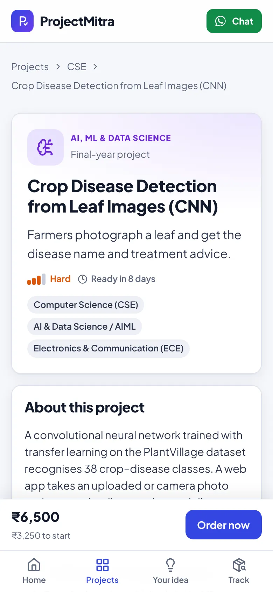
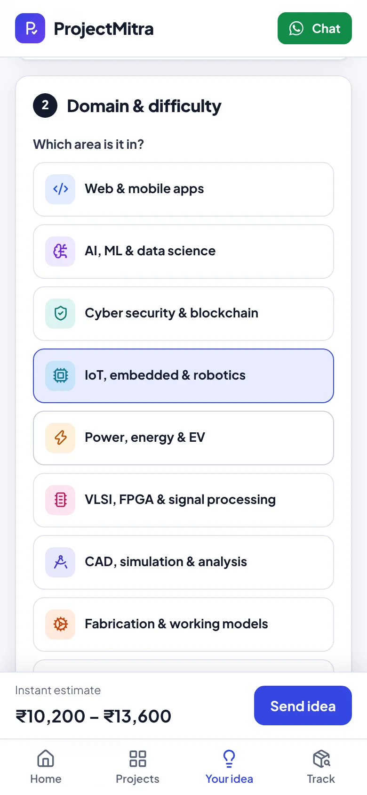
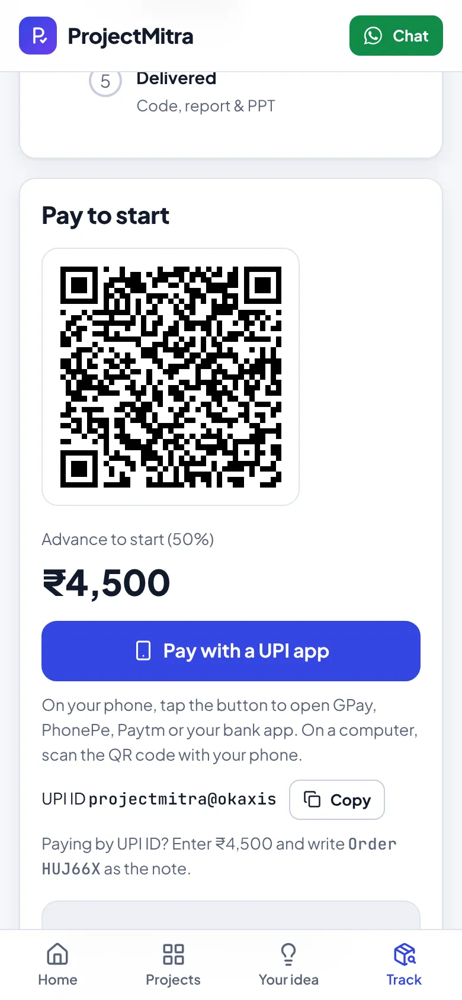
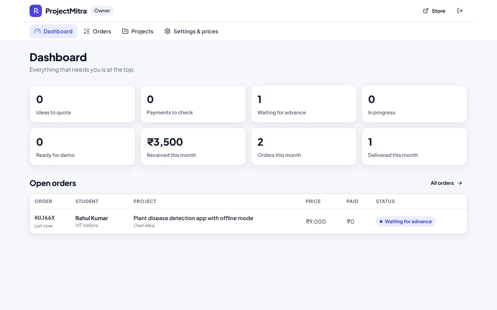
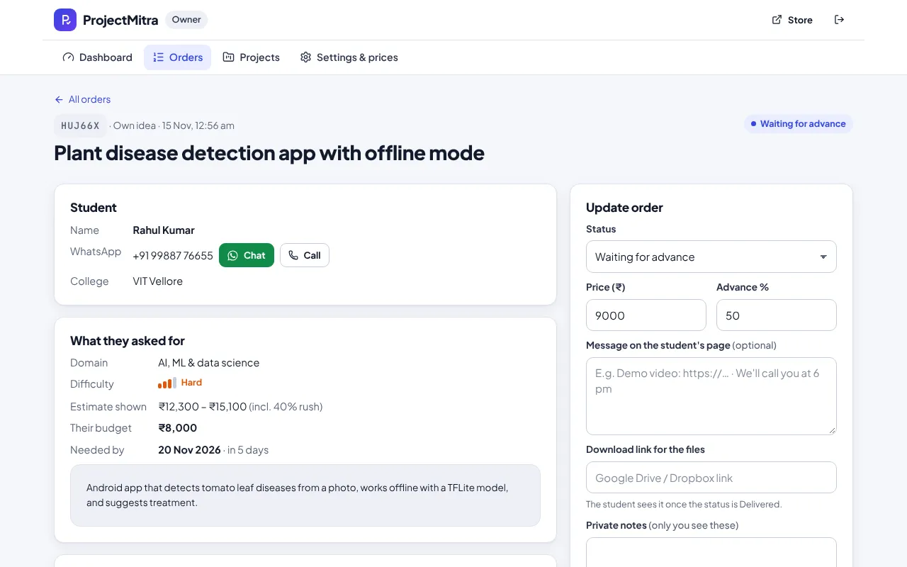

# Project store for engineering students

A website and installable phone app where engineering students buy final-year and mini projects. They can **pick a ready-made project** with a fixed price, or **describe their own idea** and get an instant price based on how hard it is. They pay a UPI advance, track progress, and download the files. You run everything from an owner panel: quote ideas, check payments, update orders and edit the catalogue and prices.

| Home | Project page | Price my idea | Pay by UPI |
|---|---|---|---|
|  |  |  |  |

| Owner dashboard | Owner: one order |
|---|---|
|  |  |

**Stack:** Next.js 15 (App Router, TypeScript) · Postgres (free Supabase database in production, a built-in one for development) · deploys to Vercel. No paid services needed.

## What students can do

- **Browse 44 sample projects** for CSE, IT, AI & DS, ECE, EEE, Mechanical and Civil, with search and filters for branch, difficulty (Easy, Medium, Hard, Expert), budget, domain and mini/final-year.
- **See exactly what they get:** source code, report, PPT, demo video, viva Q&A, and the hardware kit or working model for hardware projects.
- **Order** with optional extras (viva-prep call, code walkthrough video, IEEE paper write-up, priority delivery) and a deadline.
- **Price their own idea:** they pick the domain, difficulty and deadline, and see the estimate change as they go. Close deadlines add a rush charge. You confirm the final price.
- **Pay by UPI:** the order page shows a QR code and a "Pay with a UPI app" button for the exact amount (GPay, PhonePe, Paytm…). Then they type the transaction ID (UTR) so you can check it.
- **Track the order** (Order placed → Advance paid → Being built → Demo ready → Delivered) and download the files when it's done. Their orders are remembered on their phone, or they can find one with the order code and phone number.
- **WhatsApp everywhere:** every page can open a chat with you, with the project or order already typed in.
- **Install it as an app:** on Android, "Install the app" adds it to the home screen with a bottom tab bar; on iPhone, Share → Add to Home Screen.
- **Share links that look good:** a shared project shows a preview card with its title, price and difficulty in WhatsApp and Instagram.

## What you (the owner) can do — `/admin`

- **Dashboard:** ideas waiting for a price, payments to check, orders by stage, money received this month.
- **Quote an idea:** type the final price and save. The student's page then asks for the advance. One tap opens WhatsApp with "your project is confirmed at ₹X, pay here: link" ready to send.
- **Check payments:** search the UTR in your bank or UPI app, then tap **Received** or **Not received**. When the advance is in, the order moves to *In progress* by itself. You can also record cash or bank payments.
- **Deliver:** upload the files to Google Drive (share with "anyone with the link"), paste the link, set the status to *Delivered*. The student gets a download button.
- **Ready-made WhatsApp messages** for each stage: price and payment link, payment received, demo ready, files delivered.
- **Catalogue:** add, edit, hide or feature projects. The form suggests a price from your pricing rules.
- **Settings & prices:** business name, WhatsApp number, UPI ID, advance %, base price per difficulty, multiplier per domain, rush charges, extras, and the payment/refund policy text.

## How prices work

**Ready-made projects** have the price you set on each one.

**Students' own ideas** get an estimate:

```
base price for the difficulty × domain multiplier  +  rush charge  +  extras
```

| Difficulty | Base (default) | | Domain | Multiplier (default) |
|---|---|---|---|---|
| Easy | ₹2,000 | | Web & mobile apps, research studies | ×1 |
| Medium | ₹4,000 | | CAD, simulation & analysis | ×1.1 |
| Hard | ₹7,500 | | AI & ML | ×1.25 |
| Expert | ₹12,000 | | Security & blockchain | ×1.3 |
| | | | VLSI & signal processing | ×1.35 |
| | | | IoT/embedded, power & EV (kit included) | ×1.5 |
| | | | Fabrication & working models | ×2 |

Rush charge: +40% if the deadline is within 7 days, +20% within 14 days. Students see a range (10% below to 20% above the estimate), and you set the final price. Change any of these numbers in **Admin → Settings & prices**.

## Run it on your computer (2 minutes)

```bash
cd project-store
npm install
npm run dev
```

Open http://localhost:3000. There is nothing to set up: during development the app uses a built-in database stored in `project-store/.data/`. The owner panel is at http://localhost:3000/admin, and the password is `admin` until you set `ADMIN_PASSWORD`.

## Put it online (free database + Vercel)

1. **Database (Supabase, free).** Create a project at [supabase.com](https://supabase.com); choose the **Mumbai** region and note the database password. Click **Connect** at the top, choose **Transaction pooler**, and copy the connection string (it ends in `:6543/postgres`). Replace `[YOUR-PASSWORD]` with your database password. If the password has symbols like `@ # / ?`, reset it to letters and numbers first (Project Settings → Database).
   You don't need to run any SQL: the app creates its tables and loads the sample projects the first time it starts. Everything lives in its own `store` schema, so you can also use your existing Supabase project instead of a new one.
2. **Vercel.** At [vercel.com/new](https://vercel.com/new), import this repository and set **Root Directory** to `project-store`. Add these environment variables, then deploy:

   | Name | Value |
   |---|---|
   | `DATABASE_URL` | the connection string from step 1 |
   | `ADMIN_PASSWORD` | a long password for `/admin` (at least 12 characters) |
   | `NEXT_PUBLIC_SITE_URL` | your site's address, e.g. `https://yourbrand.vercel.app` (or your own domain later) |

3. **Settings.** Open `https://YOUR-SITE/admin`, sign in, and in **Settings & prices** enter your business name, WhatsApp number and UPI ID. Then go through **Projects**: hide the ones you can't deliver and set your own prices.
4. **Check.** Open `https://YOUR-SITE/api/health`. It lists anything still missing and shows `"ok": true` when everything is set.

`vercel.json` runs the server in Mumbai (`bom1`), next to a Mumbai database. It also calls `/api/keepalive` once a day, because Supabase's free plan pauses a database after a week without visits.

**Good to know:**
- Vercel's free *Hobby* plan is meant for non-commercial use. For a paying business, Vercel asks for the Pro plan; the app also runs on any other Next.js host (Netlify, Render, Railway…).
- This folder shares a repository with the Quán menu app. To stop each push from rebuilding both sites, set Vercel's **Ignored Build Step** (Project Settings → Git) to `git diff HEAD^ HEAD --quiet -- .` in this project.
- A free **business** UPI ID (PhonePe Business, Paytm for Business, Google Pay for Business) works most smoothly with UPI payment links; some apps limit links to personal UPI IDs.

### Optional: instant alerts on Telegram

Get a message on your phone for every new order, idea and payment:

1. In Telegram, message **@BotFather**, send `/newbot`, and copy the token it gives you.
2. Send any message to your new bot, then open `https://api.telegram.org/bot<TOKEN>/getUpdates` and copy the `"chat":{"id": …}` number.
3. Add `TELEGRAM_BOT_TOKEN` and `TELEGRAM_CHAT_ID` in Vercel and redeploy.

### Optional: put it on the Google Play Store

The site is already an installable app (PWA). To list it on Google Play, enter your site's address at [pwabuilder.com](https://www.pwabuilder.com), download the Android package, and upload it in the Google Play Console (one-time US$25 developer fee).

## Your daily routine

1. **New idea** (dashboard: *Ideas to quote*) → open it, read it, type the price, **Save** → tap **Send price & payment link**.
2. **Payment to check** → find the UTR in your bank/UPI app → **Received**. The order moves to *In progress*.
3. **Demo ready** → set the status to *Ready* → **Demo ready** message → collect the balance.
4. **Hand over** → paste the Google Drive link → status *Delivered* → **Files delivered** message.

## How it's built

| Path | What it does |
|---|---|
| `src/app/(store)/` | Student pages: home, `projects` (catalogue and project pages), `projects/[slug]/order`, `custom` (price my idea), `track` (order lookup and order page), `policies`. `actions.ts` saves orders, ideas and payment reports, with checks against spam (a hidden field for bots, at most 5 orders per phone number per hour). |
| `src/app/admin/` | Owner panel. `actions.ts` holds every owner action; each one checks the owner's sign-in. `src/middleware.ts` also keeps signed-out visitors away from `/admin`. |
| `src/lib/db.ts` | Database connection: Postgres when `DATABASE_URL` is set, otherwise the built-in PGlite database (development only). Creates the tables on first start and fills the catalogue once. |
| `src/lib/schema.ts` | Tables: `projects`, `orders`, `payments`, `settings`, all in the `store` schema. Raise `SCHEMA_VERSION` when you change it; every statement is safe to run again. |
| `src/lib/seed.ts` | The 44 sample projects. |
| `src/lib/data.ts` | Every database query. |
| `src/lib/pricing.ts` | The estimate formula, shared by the student form and the server. |
| `src/lib/settings.ts` | Owner settings with their defaults, including the default policy text. |
| `src/lib/auth.ts` | Owner sign-in: one password, a signed cookie for 30 days, at most 10 wrong tries per 15 minutes from one address. |
| `src/lib/links.ts` | WhatsApp click-to-chat and UPI payment links. |
| `src/lib/og.tsx` | Link-preview images (font: Plus Jakarta Sans, SIL Open Font License, `assets/fonts/OFL.txt`). |
| `scripts/make-icons.mjs` | Draws the app icons in `public/` and `src/app/`. |

**Security:** only the server talks to the database; on Supabase, the `store` tables are also closed to Supabase's public API. Order pages are reached through long secret links that search engines don't index. Links typed into forms must start with http(s). Changing `ADMIN_PASSWORD` signs out every device.
